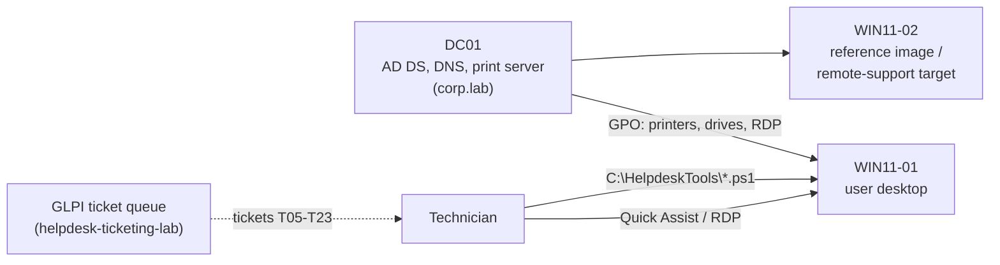

# Windows Desktop Support Lab

Domain-joined Windows 11 desktops where I reproduce and fix the problems that fill a desktop support queue: slow PCs, full disks, stuck printers, failed updates, network drops, broken profiles and missing drives. Each problem has a written runbook and, where it makes sense, a PowerShell tool that does the first-look diagnosis or the fix safely. The lab also covers printer deployment with Group Policy, building a reference image, and remote support.

## Architecture

## Toolkit

| Script | What it does | Safe by default |
|---|---|---|
| [`Get-SystemHealth.ps1`](scripts/Get-SystemHealth.ps1) | Uptime, pending reboot, disk, memory, top processes, startup apps, last update, BitLocker, Defender, last 24h errors; flags problems in plain English; optional HTML report for the ticket | Read-only |
| [`Test-NetworkBasics.ps1`](scripts/Test-NetworkBasics.ps1) | Adapter → IP (APIPA check) → gateway → DNS → HTTPS, stops at the failing layer and says what it means | Read-only |
| [`Clear-DiskSpace.ps1`](scripts/Clear-DiskSpace.ps1) | Cleans temp, update and error-report caches; lists the user's largest folders for a conversation, never deletes user data | Report-only unless `-Apply`; Recycle Bin only with `-IncludeRecycleBin` |
| [`Reset-PrintSpooler.ps1`](scripts/Reset-PrintSpooler.ps1) | Shows stuck jobs, clears the spool folder, restarts the spooler | `-WhatIf` |
| [`Reset-WindowsUpdate.ps1`](scripts/Reset-WindowsUpdate.ps1) | Resets update services and caches (renamed, not deleted), optional DISM + SFC | `-WhatIf`, admin check |

All scripts run on the Windows PowerShell 5.1 that ships with Windows (and PowerShell 7), and pass PSScriptAnalyzer with no errors or warnings, including the 5.1 syntax-compatibility check.

## Runbooks

| Runbook | Help desk tickets |
|---|---|
| [Slow PC](runbooks/slow-pc.md) | T08 |
| [Disk full](runbooks/disk-full.md) | T11 |
| [No internet](runbooks/no-internet.md) | T09, T10, T17 |
| [Printer not printing](runbooks/printer-not-printing.md) | T06, T23 |
| [Windows Update failing](runbooks/windows-update-failing.md) | T12 |
| [Temporary profile, missing mapped drive](runbooks/profile-and-drives.md) | T19, T05 |

Ticket numbers refer to the [helpdesk-ticketing-lab](https://github.com/EbubeNnaemeka/helpdesk-ticketing-lab) queue, so each runbook is used on a real ticket and linked from it.

## Setup

[`docs/lab-setup.md`](docs/lab-setup.md): VMs, domain join, printer deployment via Group Policy Preferences with item-level targeting, sysprep reference image, Quick Assist and RDP via GPO.

## Results

| Check | Result |
|---|---|
| Desktops joined to corp.lab | _fill in_ |
| Printer deployed by GPO to the target group only | _fill in_ |
| Reference image: power-on to ready time | _fill in_ |
| Tickets fixed with these runbooks/tools | _fill in_ |
| Issues found in the scripts on real Windows (and fixes) | _fill in_ |

## Resume bullet (use once you have completed and verified the lab)

> Supported domain-joined Windows 11 desktops: deployed printers and drives with Group Policy, built a sysprep reference image, and wrote PowerShell tools and runbooks for slow PCs, full disks, print spooler and Windows Update failures used to resolve [N] help desk tickets.
